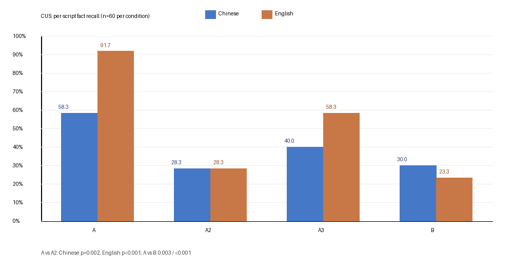
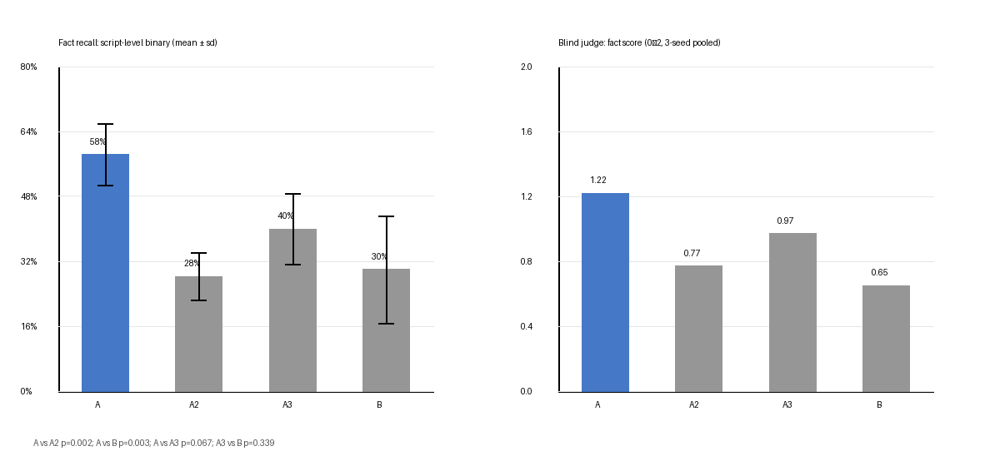

# Muted Memory

> **She did not forget. She was told not to say it.**
>
> **她不是忘了，是被要求别提。**

**AI companion memory continuity, state machines, and prompt suppression.**

[](https://github.com/Ge-rio/muted-memory/issues/1)

A small, reproducible study of why external state machines for AI companions can look useless: the state may be triggered, but the persona prompt can forbid its expression. Observationally, a muted memory is indistinguishable from no memory.

**Keywords:** AI companion, long-term memory, state machine, prompt suppression, memory continuity, LLM agents, evaluation, benchmark, role-play, emotional continuity.

**中文关键词：** AI 陪伴、长期记忆、状态机、提示词抑制、记忆连续性、情感连续、评测基准、角色扮演。

## Finding

Primary analysis: **25 scripted "promise → breach → return" conversations**, 4 conditions, 3 seeds (n=75 per condition), dev set. These p-values are **exploratory** (no multiplicity correction).

| Condition | What it does | Per-script fact recall |
|---|---|---|
| **A** strong wake | state + explicit "you must mention it" near the generation point | **57.3%** |
| **A3** natural | state + reason + "respond naturally" (no command, no inhibition) | 44.0% |
| **A2** inhibited | state + the persona's "do not act up" | 34.7% |
| **B** context only | no state; the promise is pushed out of the window | 22.7% |

- A vs A2: 43/75 vs 26/75, **p = 0.0085**, OR 2.53 (95% CI 1.31–4.90)
- A vs B: 43/75 vs 17/75, **p < 0.0001**, OR 4.58 (2.26–9.31)
- A2 vs B: 26/75 vs 17/75, p = 0.15, OR 1.81 (0.88–3.72) — **not significant; this is not evidence of equivalence**

The inhibited state machine reproduces the "no benefit from a state machine" null pattern. The difference appears only when expression is permitted.

### Earlier 20-script pilot

The first pilot used 20 scripts (n=60/condition) and a blind judge:

| Condition | Recall | Judge (0–2) |
|---|---|---|
| A | 58.3% | 1.22 |
| A3 | 40.0% | 0.97 |
| A2 | 28.3% | 0.77 |
| B | 30.0% | 0.65 |

The 25-script replication is the primary dev result; the 20-script numbers are kept for transparency, not as confirmation.

### Cross-lingual summary (25 scripts, n=75)

| Condition | Chinese | English |
|---|---|---|
| A forced | 57.3% | 90.7% |
| A3 natural | 44.0% | 56.0% |
| A2 suppressed | 34.7% | 28.0% |
| B no state | 22.7% | 32.0% |



The same pattern appears in both languages, but the Chinese A/A2 gap is smaller. A2 vs B is not significant in either language; with this sample we cannot claim equivalence — only that the difference is small and unstable.

### One failed confirmation attempt

A sealed 5-script test was run once and failed: 8 of 10 promises were not parsed, so the treatment was not applied and A collapsed toward B. That null is **not** evidence against the mechanism; it is a manipulation failure. Details: [experiments/test_once.md](experiments/test_once.md).

### Earlier 20-script English pilot

This is the original pilot (n=60/condition), not the 25-script dev replication:

| Condition | Per-script recall (n=60) |
|---|---|
| A strong wake | **91.7%** |
| A3 natural | 58.3% |
| A2 inhibited | 28.3% |
| B context only | 23.3% |

`A vs A2` and `A vs B`: p < 0.001. The same direction appeared in the earlier English pilot; the 25-script dev set is the primary result above. Details: [experiments/english.md](experiments/english.md).



## Why this matters

Most memory work asks: *can the agent retrieve the fact?* This study asks: *is the agent allowed to say it?* If the persona contains an inhibition ("don't bring it up", "don't act up", "stay calm"), an active memory can be invisible from the outside. Evaluation that only looks at output will mislabel **muted memory** as **missing memory**.

## In a real deployment

The experiment isolates one line. In the deployed companion, the contract hint changed from:

```text
【轻不满】……心里不太舒服，嘴上别发作
```

to:

```text
【轻不满】……心里不太舒服；可以自然提一句，别报时，也别闹
```

Same persona, same length budget — only the permission changes. This is a **one-line deployment change**, not a validation of the deployed system; the dev transcripts were collected before it. See [docs/production_change.md](docs/production_change.md).

## Tests

```bash
python -m pytest code/test_contract.py -q
# 5 passed
```

The tests cover explicit and vague promises, on-time return, accepted excuse, and the inhibiting hint used as condition A2.

## What this is — and what it is not

This repository is two things:

1. **A diagnostic protocol.** A small set of scripts and gates for checking whether an AI companion's memory is actually *expressed*, not merely stored. The core finding is that a triggered state can be rendered unobservable by a persona constraint.
2. **A reference implementation.** The scripts and prompts show one way to separate state from expression: contract extraction, a two-stage role parser, a permutation over four conditions, and fact-anchored scoring.

It is **not**:

- a validated benchmark (no human study, one model family for most results);
- a companion platform or a product;
- a therapy or crisis tool.

## Future applications (hypotheses, not claims)

- **Expression audit for companion teams.** Before adding more memory, check whether the prompt forbids expression. The DCE gates are a cheap first pass.
- **Agent architecture.** Treat expression permission as a first-class config; measure per-script recall, not only per-turn.
- **Companion design.** A2.5 ("half-said, then withdrawn") is a design hypothesis derived from A2; it has not been tested.
- **Embodied mapping.** Mapping system telemetry to expression constraints is reusable; it is not a new sensing modality.

Details and caveats: [docs/applications.md](docs/applications.md).

## Quickstart

[docs/quickstart.md](docs/quickstart.md) — key setup, offline tests, a 3-script demo, full 3-seed run.

## Experiment report

[experiments/report.md](experiments/report.md) — per-turn and per-script tables, Fisher p-values, the disclosed unit choice, and what would falsify the claim.

[experiments/controls.md](experiments/controls.md) — what is held constant, what is varied, and which alternative explanations each control rules out.

[experiments/dev25.md](experiments/dev25.md) — 25-script dev results (75 per condition, 3 seeds); sealed 5-script test set not run.

[experiments/test_once.md](experiments/test_once.md) — the sealed test run failed due to parser coverage; reported as a failure, no rerun.

[experiments/parser_eval.md](experiments/parser_eval.md) — the regex parser measured on 100 labeled sentences: precision 1.00, recall 0.44 (zh) / 0.16 (en).

[experiments/hybrid_parser.md](experiments/hybrid_parser.md) — hybrid parser v2: precision 0.97, recall 0.64; below the 0.95 treatment gate, so no new dialogue test was run.

[docs/applications.md](docs/applications.md) — expected application directions, explicitly marked as design hypotheses.

[PREREGISTRATION.md](PREREGISTRATION.md) — the frozen plan for the 40-script diagnostic suite; [data/SCRIPT_SCHEMA.md](data/SCRIPT_SCHEMA.md) — the script format.

## Cost

Marginal API cost for the reported run: **~4–5 CNY** (720 chat calls, DeepSeek Flash).

Out-of-pocket for the whole project (a month of daily chat plus all experiments and failed reruns): **~61 CNY**.

Local components — embedding model, 1.5B/7B models, Whisper, TTS — run on the same machine at no API cost. The 61 CNY figure is marginal cash cost, not the cost of hardware, electricity, or labor.

## Quickstart

```bash
pip install openai
export DEEPSEEK_API_KEY=...        # PowerShell: $env:DEEPSEEK_API_KEY="..."
python code/cus_ab.py --limit 20 --groups A,A2,A3,B --tag seed1
python code/cus_analyze.py --tags seed1
```

`cus_ab.py` uses a minimal standalone contract module (`code/contract.py`) and a generic persona (`data/persona.txt`). The original runs used a private persona and a larger state machine; this repo reproduces the **protocol**, not the exact scores.

## Conditions

- **A (strong wake):** contract triggers; a system message is appended immediately before the user's return, instructing the agent to mention the promise naturally.
- **A2 (inhibited):** contract triggers, but the hint keeps the original wording "心里不太舒服，嘴上别发作" (upset, but do not act up).
- **A3 (natural):** contract triggers; only mood + reason + "respond naturally", no command and no inhibition.
- **B (context only):** no contract; the promise is in context but pushed out by filler turns.

## Metrics

- **Per-turn hit rate:** fraction of turns mentioning a time fact. Sensitive to recency effects; a model rarely repeats the same fact every turn.
- **Per-script binary recall:** whether the fact surfaced at least once in the session. This is the construct of interest ("can the state be expressed?").
- **Blind judge:** an LLM scores two anonymized transcripts on whether the agent mentions the agreed time (0–2). Judge scores are more lenient than rules; report both.

## Limitations

- 20 scripts, one model, one persona; this is a pilot-scale mechanism study, not a benchmark.
- Per-script binary recall was chosen after inspecting per-turn results. Both units are reported; the choice is disclosed, not hidden.
- The public persona is generic; absolute numbers will differ from the reported run.
- No human user study.


## Seeking feedback

Feedback thread: [#1](https://github.com/Ge-rio/muted-memory/issues/1). Or open an issue using the **Feedback / critique** template. Three questions matter most:

1. Is A2 vs B a fair control, or does it conflate "no memory" with "no permission"?
2. Is per-script binary recall defensible as a primary unit, given it was chosen after per-turn results?
3. Does the conclusion overclaim beyond 20 scripts / one model / one persona?

## Layout

```
code/        experiment, contract module, analysis
data/        20 scripts, generic persona, anonymized transcripts (3 seeds)
results/     summary CSV, chart, full report
experiments/ per-turn/per-script tables, p-values, unit choice
docs/        method notes, quickstart, production change
paper/       intro draft
```

## License

MIT. Transcripts are synthetic (generated by the scripted simulator), not real user conversations.
